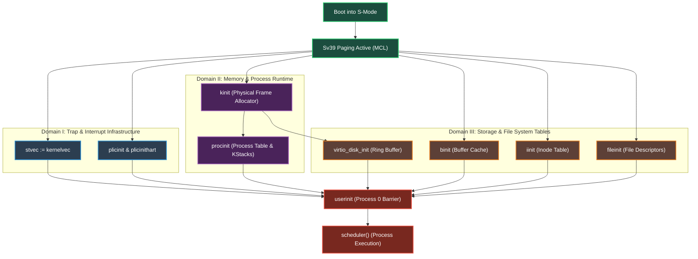

# 10. Boot Dependency Graph (DAG) & Parallel Initialization

## Motivation

In MIT xv6-riscv, `main()` executes a strictly sequential sequence of 15 initialization functions on CPU Core 0, while all other cores (`cpuid() != 0`) spin idly in a busy-wait loop (`while (started == 0);`).

When we analyze the true **data and resource dependencies**, this sequential ordering is artificial. Most subsystems are mutually orthogonal and can be executed concurrently, partitioned across cores, or pre-computed at compile time in Lean 4.

---

## The Boot Dependency Graph (DAG)

---

## Domain Breakdown & Independence

Once virtual memory is active (via the Machine Configuration Language), boot initialization splits into three mutually independent branches:

### Domain I: Trap & Interrupt Infrastructure
- **Components**: `stvec := kernelvec`, `plicinit()`, `plicinithart()`.
- **Dependencies**: None on other subsystems. Only requires CSR writes and PLIC MMIO address mapping (which is already mapped at `0x0c000000` via MCL).
- **Concurrency**: Can run concurrently with memory allocation and file system setup.

### Domain II: Memory & Process Runtime
- **Components**: `kinit()`, `procinit()`.
- **Dependencies**:
  - `kinit()` requires the unmapped RAM pool (`0x80200000..0x88000000`) to be accessible.
  - `procinit()` requires `kalloc()` to allocate per-process kernel stacks and user page table nodes.
- **Concurrency**: Independent of Domain I and Domain III static tables.

### Domain III: Storage & File Tables
- **Components**: `binit()`, `iinit()`, `fileinit()`, `virtio_disk_init()`.
- **Dependencies**:
  - `binit()` initializes the 30 in-memory block buffer headers (`bcache.buf`).
  - `iinit()` initializes the in-memory inode table cache (`itable.inode`).
  - `fileinit()` initializes the open file descriptor table (`ftable.file`).
  - None of these three static tables depend on each other, on `kinit`, or on device hardware.
  - `virtio_disk_init()` requires 1 page from `kalloc()` for the descriptor ring buffer and interrupts routed from PLIC.

---

## The Synchronization Barrier: `userinit`

The only strict synchronization point in the entire boot process is `userinit()`:
- `userinit()` creates Process 0 (allocates its `proc` struct, creates its Sv39 user page table, copies `initcode` bytes into user virtual address 0, and sets `trapframe.epc = 0`).
- It requires:
  1. Trap vector configured (`stvec`).
  2. Memory allocator ready (`kalloc`).
  3. Process table ready (`procinit`).
  4. Device interrupts enabled (`PLIC`).
- Once `userinit()` completes, all cores can safely jump into `scheduler()`.

---

## Architectural Opportunities in Lean 4

### 1. Compile-Time Static Table Pre-Initialization
In C xv6, `binit()`, `iinit()`, `fileinit()`, and `procinit()` run imperative loops that call `initlock(&lk, "name")` to initialize spinlocks and zero out arrays.
In Lean 4, these structures can be emitted directly as constant data structures in `.bss` or `.data`, eliminating runtime CPU cycles entirely—extending the philosophy that made MCL successful for page tables.

### 2. Multi-Hart Boot Pipeline
Instead of letting secondary CPU cores spin in busy-wait while Hart 0 does everything:
- **Hart 0**: Initializes physical frame allocator (`kinit`) and process table (`procinit`).
- **Hart 1**: Initializes device interrupt routing (PLIC priorities) and disk queues.
- **All Harts**: Concurrently configure local trap vectors (`stvec := kernelvec`) and local timer interrupts.
- **Barrier**: Harts synchronize on an atomic barrier before entering `scheduler()`.
